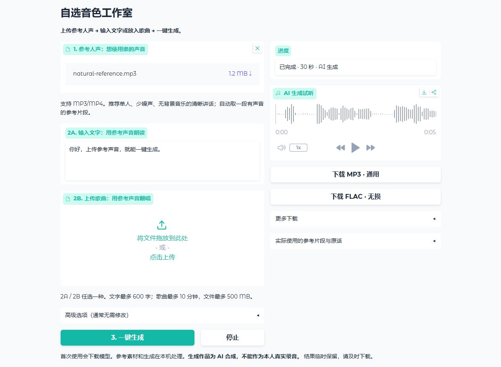

# Custom Voice Studio

[使用说明](README.md) · [Windows download](https://github.com/2009Wu/custom-voice-studio/releases/latest/download/Custom-Voice-Studio-Windows.zip) · [Hugging Face](https://huggingface.co/spaces/Little-Wang/custom-voice-studio)

Upload a reference voice (MP3/MP4/WAV/M4A/FLAC), then enter text OR upload an existing vocal song, and click Generate. No fixed person's reference or separate speaker training is used.

Extract Custom-Voice-Studio-Windows.zip completely, run Start Custom Voice Studio.exe and click 安装并打开工作室 (Set up and open). Keep the launcher open. Advanced settings are optional.

For TTS, an internal CPU Whisper process transcribes the selected reference clip, then Qwen3-TTS 0.6B Base generates the requested text using that clip and transcript. Transcription can be corrected manually in advanced settings. Singing uses Seed-VC with the uploaded reference and Demucs separation. Default 40 steps, pitch and vocal-forward mix are preserved.

Use a clear, single-speaker reference of at least 3 seconds. The app scans up to 90 seconds after the selected start and chooses an active clip, by default up to 20 seconds. This is energy-based selection, not speaker diarization. Multiple speakers, noise or background music can reduce similarity. Instrumental-only songs do not create singing or lyrics.

Requires Windows 10/11 x64, a 6 GB-class or larger NVIDIA CUDA GPU and driver, recommended 16 GB RAM and 30 GB free setup disk space. Physical 6 GB hardware remains unvalidated. Memory profiles trade CPU work/transfers for GPU memory. See VALIDATION.md for actual checks.

Independent app runtime/models live in .runtime/.cache. No system Python or external inference API is used. First setup/model downloads require internet. Defaults to localhost port 7870. Outputs are temporary: save MP3, lossless FLAC/WAV and optional MP4 promptly.

Software is GPL-3.0, derived from Wang Hongwen Voice Studio v0.3.0. Upstream code/model notices are in THIRD_PARTY_NOTICES.md. No personal voice reference or model weights are bundled in the ZIP. All generated audio is synthetic, not an authentic recording.

## Desktop shortcut

First launcher run and successful setup create a current-user desktop shortcut. After setup, double-click it to start the local server and open the studio directly. A second click reuses the running instance. Keep the extracted app folder. After moving it, run the EXE from the new location or use 创建 / 修复桌面快捷方式 (Create / repair desktop shortcut). Downloading a ZIP alone does not execute the app. Desktop permission errors do not invalidate installation.

## Disk use

Setup/startup removes only unused PyTorch build-time `.lib` files and `ffplay.exe` from this app’s private runtime. The measured saving on the pinned Windows runtime is 980,103,826 bytes (0.91 GiB). Model tensors, runtime DLLs, bytecode caches, precision, inference settings and export formats are unchanged. The self-contained development compiler/linker workflow is not part of this inference runtime; developers needing custom C++ extensions should use a separate full PyTorch environment. Reserve 30 GB during setup.

## Setup space versus installed size

The 30 GB requirement is free space before first setup, including temporary downloads and extraction; it is not permanent installed size. The measured Custom Voice Studio installation with all cached models is about 11.25 GiB. The Wang app uses the same main runtime/models; its independent total was not remeasured this update. Size varies with caches and results. This update removes a further 183,939,829 bytes of unused upstream demo frontend assets, development headers and FFmpeg manuals, while retaining licenses, the served UI, all model weights, runtime DLLs and useful caches. Subsequent startups use a marker to avoid repeating the file scan; repair setup refreshes it.

## Saved works and updates

Completed files are now saved permanently under Documents / Voice Studio作品, separately for each studio. Reopen them from Works history. Audition 10/15/20 seconds before generating a full cover; the accepted excerpt is reused. Redo a selected interval (up to 120 seconds) as a new work, retaining the original. Editable source material expires after 7 days or a 5 GB budget; exports stay. Custom Voice Studio can preview, crop and favorite a reference locally.

Both Windows studios use a shared model cache under LocalAppData / VoiceStudios / models. Existing identical files can be hard-linked without changing model bytes. Runtime environments remain separate. Updates are explicit: check, download and verify, then install/restart; code backups support rollback and interrupted-update recovery. User recordings and prompts are excluded from diagnostics. See [workflow guide](docs/作品与更新.md). First upgrade from an older release requires the complete ZIP. No voice engine or default quality settings were changed.
