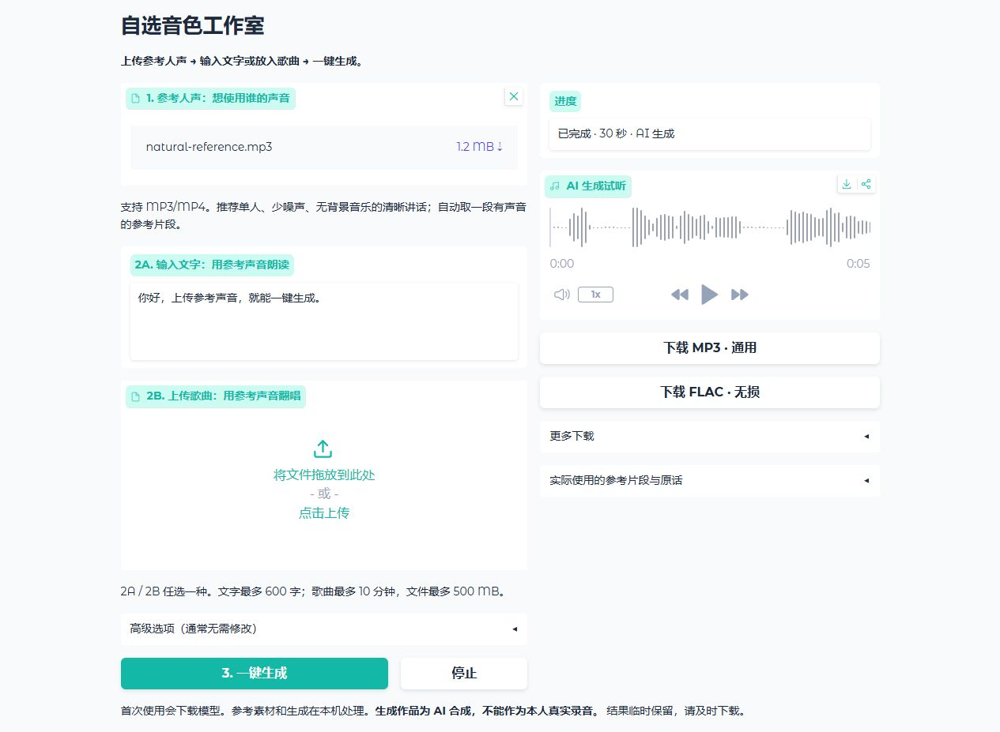

# 自选音色工作室 · Custom Voice Studio

[English](README.en.md) · [安装说明](docs/Windows-Setup.zh-CN.md) · [测试记录](VALIDATION.md)

选一段参考声音，让它读你写的文字，或翻唱你上传的歌曲。支持 MP3、MP4、WAV、M4A、FLAC，在自己的 Windows 电脑上运行。

**[下载 Windows 版](https://github.com/2009Wu/custom-voice-studio/releases/latest/download/Custom-Voice-Studio-Windows.zip)** · [Hugging Face 项目页](https://huggingface.co/spaces/Little-Wang/custom-voice-studio) · [更新记录](CHANGELOG.md)

当前版本 **v0.1.1**。首次安装后会创建桌面快捷方式，以后双击图标就能打开。

## 桌面一键打开

完整解压后首次运行启动器，会自动在当前用户桌面创建「自选音色工作室」快捷方式；安装成功后也会补建。以后双击桌面图标，程序自动启动本地服务并打开网页，无需再次点击「打开工作室」。重复点击会打开已有实例。首次使用仍需完成安装，单纯下载 ZIP 不会自动执行程序。

请保留完整程序文件夹。移动程序后，运行新位置的 EXE，或在启动器底部点击「创建 / 修复桌面快捷方式」。桌面权限受限时，快捷方式失败不会阻止安装；仍可运行 EXE。使用期间保持启动器开启。

## 开始使用

1. 完整解压 **Custom-Voice-Studio-Windows.zip**。
2. 双击 **Start Custom Voice Studio.exe**，首次点击 **安装并打开工作室**。
3. 上传参考人声；输入文字或上传歌曲，点击 **3. 一键生成**。两种内容一次只选一种。
4. 试听并下载 MP3 或无损 FLAC；更多下载中有 WAV、MP4 和参数记录。

保持启动器开启。无需系统 Python、Docker 或终端命令。以后点击「打开工作室」即可。

## 参考人声怎么选

推荐单人、清晰、少噪声、无背景音乐的讲话，至少 3 秒。长音视频会在起点后的前 90 秒中按声音活动选取最长 20 秒片段；可在高级选项调整参考起点和长度（5–25 秒）。这不是说话人分离，混有多个人的录音请先选目标人物的单人片段。

文字语音会在本机自动识别参考片段原话，再交给 Qwen3-TTS 使用；这一步用于参考提示，不是一个面向用户的录音转文字功能。完成后可展开「实际使用的参考片段与原话」核对。识别不准确时，可调整片段或在高级选项填写该片段的准确原话。

歌曲必须含原唱；纯伴奏不会自动创作歌词或唱腔。翻唱使用上传的人声作为参考，保留原曲旋律和音高，默认 40 步、主唱 +4.5 dB、伴奏 −1.5 dB。

## 配置与文件

64 位 Windows 10/11、6 GB 级以上 NVIDIA 显卡及可用驱动；建议 16 GB 以上系统内存，安装前预留 30 GB 空间。自动按可用显存选择节省/均衡/性能档位。低档使用 CPU 分离伴奏和分阶段 GPU 载入，速度较慢。

物理 6 GB 显卡兼容性仍需实机验证；本机测试范围见 [VALIDATION.md](VALIDATION.md)。不能保证任意人物、任意录音都达到相同相似度。

首次安装和首次模型下载需联网。生成与参考识别均在本机运行，不调用外部推理 API。`.runtime` 是本程序独立运行环境，`.cache` 是模型；无需保留或运行王洪文工具才能使用本程序。运行目录、临时任务目录和默认端口（7870）独立。

安装 ZIP 无损压缩，不含模型和私有环境，也不含任何人物参考录音。FLAC 解码样本与 WAV 完全一致；MP3 保持 320 kbps。生成结果和参考片段临时保留，请及时下载保存。

## 许可与来源

软件采用 [GPL-3.0](LICENSE)。基础流程派生自 [Wang Hongwen Voice Studio v0.3.0](https://github.com/2009Wu/wang-hongwen-voice/tree/v0.3.0)，新版本使用用户上传参考音频。Seed-VC、Qwen3-TTS、Whisper、Demucs 等组件及模型许可见 [THIRD_PARTY_NOTICES.md](THIRD_PARTY_NOTICES.md) 和 [models.json](models.json)。用户上传的录音不属于软件 GPL 授权范围。

**生成作品是 AI 合成演绎，并非人物真实录音。** 分享时请保留合成标注。

